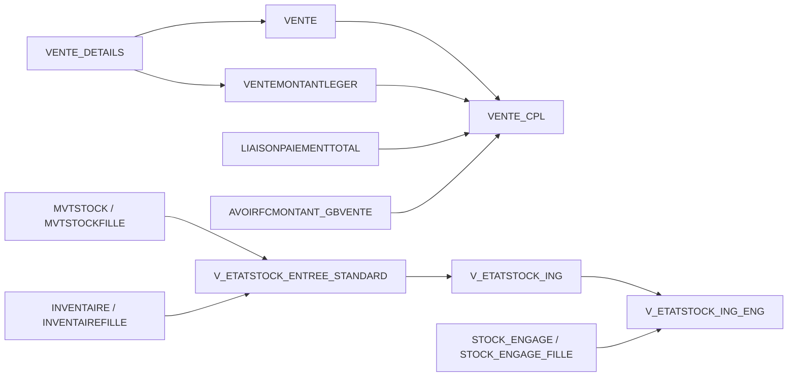
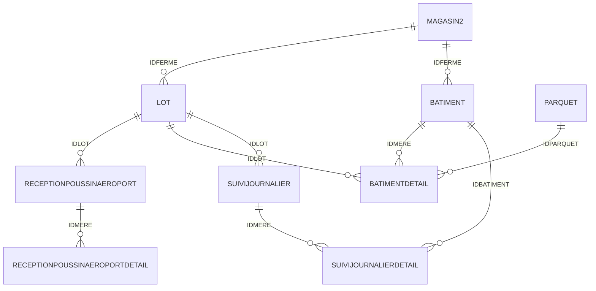

# Cartographie de la base Arbiochem

Lecture du schéma `ARBIOCHEMSTANDARD` de la base locale `arbiochem-oracle`, rapprochée des sources Java et JSP du projet. Les accès à Oracle ont porté sur les métadonnées, dans des transactions de lecture seule. Aucune ligne de données métier n’a été exportée et aucun SQL de définition n’a été exécuté.

| Élément | Nombre relevé |
|---|---:|
| Tables | 516 |
| Vues | 1309 |
| Colonnes exposées dans le dictionnaire des tables et vues | 22361 |
| Contraintes de clé primaire | 486 |
| Contraintes uniques | 10 |
| Clés étrangères | 518 |
| Vues invalides | 43 |
| Fichiers Java et JSP parcourus pour les références | 2563 |

## Où retrouver les informations

- [Tables](tables.md) : colonnes, types, nullabilité, clés, liens entrants et vues dépendantes.
- [Vues](vues.md) : colonnes, dépendances, statut, erreurs et références dans le code.
- [Relations](relations.md) : les clés étrangères réellement déclarées dans Oracle.
- [Modules](modules.md) : index indicatif par domaine métier.
- [tables.sql](tables.sql) : définitions de tables restituées par `DBMS_METADATA.GET_DDL`, avec les attributs de segment retirés.
- [vues.sql](vues.sql) : déclarations de vues avec en-têtes `DBMS_METADATA.GET_DDL` et corps contrôlés dans `USER_VIEWS.TEXT`.
- [schema.json](schema.json) : métadonnées structurées, sources SQL, définitions et erreurs Oracle.
- [usages-code.json](usages-code.json) : fichiers, lignes et relations de mapping relevés dans les sources.
- [analyse-vues.json](analyse-vues.json) : structure SQL et dépendances de chaque vue.

## Comment les données sont organisées

Les documents sont généralement séparés en une table principale et une table de lignes : `VENTE` / `VENTE_DETAILS`, `MVTSTOCK` / `MVTSTOCKFILLE`, `FACTUREFOURNISSEUR` / `FACTUREFOURNISSEURFILLE`, `FABRICATION` / `FABRICATIONFILLE`, `COMPTA_ECRITURE` / `COMPTA_SOUS_ECRITURE`, ou les couples mère/détail de l’élevage.

Les variantes `LIB` ou `CPL` sont souvent des vues qui joignent les référentiels pour afficher les libellés, les états et les montants. Les variantes de regroupement utilisent `SUM`, `GROUP BY` ou des fonctions analytiques ; d’autres vues filtrent les documents par état. La définition SQL reste la référence : le nom seul ne suffit pas à connaître le résultat.

APJ utilise `setNomTable(...)` aussi bien avec les tables qu’avec les vues. Ainsi `Vente` utilise `VENTE`, tandis que `VenteLib` utilise `VENTE_CPL`. Les objets de saisie peuvent utiliser une vue puis enregistrer dans une table : `InsertionVente.createObject()` redirige vers `VENTE`.

Les clés étrangères enregistrées dans Oracle et les relations utilisées par l’application sont distinctes. Par exemple, les jointures de `VENTE_DETAILS_LIB` et du stock relient les articles à `AS_INGREDIENTS` même lorsque la colonne concernée ne porte pas de clé étrangère déclarée. Le catalogue ne transforme pas ces jointures en contraintes.

## Ventes et stock

Ce diagramme montre les flux de calcul SQL, pas uniquement les contraintes de clé étrangère.

- `VENTEMONTANTLEGER` calcule les montants par facture et devise à partir des lignes, des remises, des frais et des articles. `CALORIE` est notamment utilisé dans le calcul du poids et des frais de livraison.
- `VENTE_CPL.MONTANTRESTE` est calculé à partir du TTC, des règlements et des avoirs. La vue joint aussi la livraison et l’écriture comptable.
- `V_ETATSTOCK_ENTREE_STANDARD` travaille par entrée source (`MVTSRC`), en tenant compte du dernier inventaire validé et des sorties ultérieures ; elle exclut les articles de type `CUMP`.
- `V_ETATSTOCK_ING` agrège par produit et magasin et complète avec les mouvements sans source. Le solde tient compte de l’inventaire, des entrées et des sorties.
- `V_ETATSTOCK_ING_ENG` ajoute les mouvements des réservations : les sorties engagées réduisent le disponible. Son agrégation ne filtre pas elle-même l’état des documents `STOCK_ENGAGE`.
- Les vues de stock utilisent notamment `ETAT >= 11` pour les inventaires et mouvements physiques, et excluent le type `TPMVST000023` dans les branches observées.

## Élevage : les liens concrets

Ce diagramme représente une sélection des clés étrangères déclarées. Certaines clés sont nullables ; leur caractère obligatoire se lit dans le catalogue des colonnes.

- `LOT` relie la ferme, l’article, la souche, l’origine, la catégorie et le programme zootechnique. `LOT_LIB` calcule l’âge à partir de `DATEECLOSION` et de `SYSDATE`.
- Les `IDFERME` de `LOT`, `BATIMENT` et `SUIVIJOURNALIER` renvoient à `MAGASIN2.ID`.
- `RECEPTIONPOUSSINAEROPORT` décrit la réception du lot. Ses lignes détaillent la quantité par sexe et qualité.
- `BATIMENTDETAIL` associe un bâtiment, un parquet, un lot et un sexe. La table possède une colonne `EFFECTIF`, mais `BATIMENTDETAIL_LIB.EFFECTIF` est une expression calculée : `NVL(SURFACE * DENSITE, 0)`.
- `PARQUET_BATIMENT_LIB` fournit les parquets associés à chaque bâtiment à partir de `BATIMENTDETAIL`.
- `TRIAGEBATIMENTPARQUET` et ses lignes enregistrent les affectations avec bâtiment, parquet, sexe, qualité et quantité.
- `QTE_DISPO_LOT_SEXE_QUALITELIB` totalise les réceptions par lot/sexe/qualité. Elle ne soustrait pas les affectations et ne filtre pas l’état des réceptions dans son propre SQL.
- `V_QTE_DISPO_LOT_SEXE_QUALITE` totalise les lignes de triage par lot/sexe/qualité. Elle ne calcule pas une soustraction réception moins affectation et ne filtre pas l’état des triages dans son propre SQL.
- `SUIVIJOURNALIERDETAIL` conserve notamment les entrées, le tri, la mortalité, les culls, l’aliment, l’eau et les températures par bâtiment et parquet.

## État des vues

43 vues sont marquées `INVALID` par Oracle. Le catalogue conserve leurs erreurs sans lancer de recompilation ou de correction. Exemples :

- `ENCAISSEMENT_DETAILS_LIB` attend `ENCAISSEMENT_DETAILS.IDCATEGORIECAISSE`, absent des colonnes relevées dans cette table. Plusieurs vues d’encaissement dépendent de cette structure.
- `AS_BONCOMMANDE_FILLE_AVEC_PRIX` référence `BL.PRODUIT`, qu’Oracle signale comme identifiant invalide.
- `AS_INGREDIENTXMAGASIN2` et `INVENTAIREFILLEMERE` ont une erreur de colonne définie de manière ambiguë.
- Plusieurs vues de carton référencent des tables ou vues absentes ; d’autres sont invalides par dépendance à une vue déjà en erreur.

Toutes les vues invalides : [AS_BONCOMMANDE_FILLE_AVEC_PRIX](vues.md#as-boncommande-fille-avec-prix), [AS_INGREDIENTXMAGASIN2](vues.md#as-ingredientxmagasin2), [BC_CLIENT_FILLE_CPL_LIB_VISEE](vues.md#bc-client-fille-cpl-lib-visee), [BC_GROUPE_ING](vues.md#bc-groupe-ing), [BLC_NONFACTURE](vues.md#blc-nonfacture), [BONCOMMANDEDETAILSCARTON_CPL](vues.md#boncommandedetailscarton-cpl), [CARTONFILLE_CPL](vues.md#cartonfille-cpl), [CATEGORIELIB](vues.md#categorielib), [ENCAISSEMENT_BON](vues.md#encaissement-bon), [ENCAISSEMENT_CHEQUE](vues.md#encaissement-cheque), [ENCAISSEMENT_DETAILS_LIB](vues.md#encaissement-details-lib), [ENCAISSEMENT_ESPECES](vues.md#encaissement-especes), [ENCAISSEMENT_FANILO](vues.md#encaissement-fanilo), [ENCAISSEMENT_LIB](vues.md#encaissement-lib), [ENCAISSEMENT_MVOLA](vues.md#encaissement-mvola), [ENCAISSEMENT_ORANGEMONEY](vues.md#encaissement-orangemoney), [ENCAISSEMENT_PRECISION_TOTAL](vues.md#encaissement-precision-total), [ENCAISSEMENT_RESUME](vues.md#encaissement-resume), [ENCAISSEMENT_TPE](vues.md#encaissement-tpe), [ENCAISSEMENT_VISA](vues.md#encaissement-visa), [EQUIVALENCE_LIBCOMPLET](vues.md#equivalence-libcomplet), [EQUIVALENCE_QTE](vues.md#equivalence-qte), [INVENTAIREFILLECOMPLET](vues.md#inventairefillecomplet), [INVENTAIREFILLEMERE](vues.md#inventairefillemere), [PRODUITCOMMANDECARTON](vues.md#produitcommandecarton), [PRODUITCOMMANDEFILLECARTON](vues.md#produitcommandefillecarton), [PRODUITSOUSCARTON](vues.md#produitsouscarton), [RESSOURCEPARFABCOMPLET_VISEE](vues.md#ressourceparfabcomplet-visee), [RESULTATPREVGROUPMOIS](vues.md#resultatprevgroupmois), [RESULTATPREVGROUPSEMAINE](vues.md#resultatprevgroupsemaine), [ST_ARTICLELIB_PU](vues.md#st-articlelib-pu), [ST_ARTICLE_EQUIVALENCE](vues.md#st-article-equivalence), [UNITES_TRAIT](vues.md#unites-trait), [VENTEDEP_GRAPH](vues.md#ventedep-graph), [VENTE_CARBU_CLIENT](vues.md#vente-carbu-client), [VENTE_LIB_ANNULEE](vues.md#vente-lib-annulee), [VENTE_LIB_CREE](vues.md#vente-lib-cree), [VENTE_LIB_VISEE](vues.md#vente-lib-visee), [VUE_CARTONFILLE_IDMERE](vues.md#vue-cartonfille-idmere), [VUE_CARTONFILLE_SUM](vues.md#vue-cartonfille-sum), [VUE_SUIVI_CARTON](vues.md#vue-suivi-carton), [VUE_SUIVI_CARTON_LIVRAISON](vues.md#vue-suivi-carton-livraison), [V_ETATSTOCK_ENTREE_DMDACHAT](vues.md#v-etatstock-entree-dmdachat).

## Portée et fidélité de la cartographie

Cette cartographie décrit la base locale consultée. Les références de code sont extraites statiquement et peuvent inclure des commentaires ; les noms calculés à l’exécution ne sont pas exhaustifs. Les libellés de module sont indicatifs. Seules les métadonnées et les références au code sont incluses.

Les noms exacts sont conservés, y compris la casse des identifiants Oracle entre guillemets. Le schéma contient ainsi deux vues distinctes : `AS_BONDELIVRAISONCLIENT_LIB` et `AS_BONDELIVRAISONCLIENT_lib`. Les références statiques du code sont normalisées en majuscules pour les noms utilisés sans guillemets ; elles ne suffisent pas à attribuer une utilisation à une variante entre guillemets.

Les corps des 1 309 vues ont été lus directement dans `USER_VIEWS.TEXT`. Les fins de ligne sont normalisées. Pour 46 vues, la restitution du corps par `DBMS_METADATA.GET_DDL` différait du texte direct ; `vues.sql` utilise donc le texte direct. La restitution originale reste conservée dans `schema.json` pour traçabilité.
